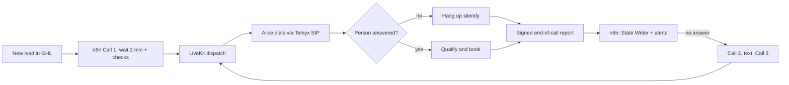

# Desert Comfort HVAC: Speed-to-Lead Voice Agent on LiveKit

A self-hosted outbound AI voice agent that calls new HVAC leads two minutes after they fill out a form, qualifies them and books the visit. It never talks into a voicemail, and it retries leads who don't answer. Built on LiveKit Agents with OpenAI GPT-Live-1, n8n and GoHighLevel, over a Telnyx SIP trunk.

## What it does

- A new lead in GoHighLevel (GHL) triggers n8n. Two minutes later n8n checks the lead can be called (no do-not-disturb, right stage, not already handled by a person, a valid phone number), then dispatches the agent.
- The agent dials the lead itself through the SIP trunk and stays silent until it knows a person answered. A voicemail, a phone menu or silence ends the call without a word.
- "Alice" opens with one line: who she is, that she's a digital assistant, why she's calling, and whether the call can be recorded. A "no" to recording switches to no-recording mode, and the call carries on.
- She asks the qualifying questions, scores the call as an emergency (inside temperature 90 °F or higher) or standard, quotes the matching fee, checks the service area and books the visit.
- After the call, the agent sends one signed end-of-call report. n8n updates GHL through the State Writer, sends alerts and decides the next attempt.
- A lead who doesn't answer gets Call 2 after 5 minutes, then a text, then Call 3 twelve hours later. After that the lead is marked exhausted.

## How it works



## What's in this repo

```
agent/          The outbound agent, its prompt, machine detection and consent handling
n8n/            Three n8n workflows (see below)
state_writer/   The State Writer's decision code, with its own README
docs/research/  Research behind the outbound design and the voicemail detection
```

| Workflow | Nodes | What it does |
|---|---|---|
| `speed-to-lead-flows.json` | 107 | Call 1, the end-of-call report with the no-answer router, and Call 3 |
| `state-writer.json` | 26 | The one place a contact's stage changes |
| `contact-gate.json` | 12 | Checks do-not-disturb and the speed-to-lead rules before a call or a text |

`agent/receptionist-prompt.md` is included because the outbound prompt reuses its qualifying, fee and booking sections.

## Stack

| Layer | Tool |
|---|---|
| Voice | LiveKit Agents with OpenAI GPT-Live-1, self-hosted |
| Telephony | Telnyx SIP trunk, outbound dial from LiveKit SIP |
| Machine detection | LiveKit AMD (Deepgram speech-to-text, a small LLM through OpenRouter) plus Silero VAD audio checks |
| Orchestration | n8n |
| CRM and calendars | GoHighLevel |
| State and locks | Redis, n8n Data Tables |
| Alerts | Slack, email |

## Agent tools

`check_availability_desertcomfort`, `book_appointment_desertcomfort`, `radius_checker_desertcomfort`, `transfer_to_human`, `opt_out_desertcomfort`, `grant_opt_in_desertcomfort`, `decline_recording`, `get_current_time` and `hangup`.

## Call outcomes

Answered calls use the receptionist's outcomes (`booked_standard`, `booked_emergency`, `qualified_not_booked`, `out_of_area`, `do_not_call` and others), plus `not_interested`, `callback_requested` and `wrong_person`. Unanswered calls end as `voicemail`, `silent_pickup`, `no_answer` or `dial_failed`. Only `voicemail`, `silent_pickup` and `no_answer` move the lead to the next attempt. Every other outcome stops the sequence.

## Key design decisions

- **Never speak into a voicemail.** Only a clear "human" verdict keeps the call. Voicemail, a full mailbox, a phone menu and "uncertain" all end it silently. LiveKit's own default treats "uncertain" as a person; this agent doesn't.
- **No hang-up under 7.5 seconds.** Telnyx penalizes a high share of outbound calls of 6 seconds or less, and a voicemail counts as connected. So any hang-up the agent decides on waits until the call is at least 7.5 seconds old.
- **A "no" to recording never ends the call.** Recording stops at once, the file is deleted unless the lead gave a clear yes, and the end-of-call report drops the lead's own words.
- **The code builds the opening line.** It knows the attempt number, so Call 2 and Call 3 open differently. The model only says the line.
- **The agent always reports.** Every call, answered or not, sends exactly one report, through an outbox that resends until n8n confirms it (for up to 7 days). n8n ignores repeats with a Redis guard.
- **Every flow stands alone.** Call 1, the end-of-call chain and Call 3 each have their own webhook and their own checks. Call 3 re-reads the lead from GHL, requires the lead still to be at `no_answer_call_2`, and respects quiet hours.
- **Same qualification as the receptionist.** The five qualifying facts, the 90 °F emergency rule, the fees, information tracking and the safety rules carry over unchanged from the inbound prompt.

## Tests

Machine detection was tuned on real test dials. The n8n chain was tested end to end with signed synthetic reports. The agent has 12 test suites with 684 checks, and the State Writer has 68 more.

## Placeholders

| Placeholder | Replace with |
|---|---|
| `your-n8n-instance.example.com` | Your n8n base URL |
| `your-livekit-server.example.com` | Your LiveKit server URL |
| `YOUR_WEBHOOK_PATH` | The webhook paths you choose |
| `YOUR_GHL_LOCATION_ID` | Your GHL location ID |
| `YOUR_GHL_FIELD_ID_LEAD_STATUS`, `YOUR_GHL_FIELD_ID_STAGE` | Your GHL custom field IDs (the name says which field) |
| `YOUR_BUSINESS_PHONE_NUMBER` | The phone number texts are sent from |
| `YOUR_SLACK_USER_ID` | The Slack user who gets the alerts |
| `YOUR_ERROR_WORKFLOW_ID`, `YOUR_STATE_WRITER_WORKFLOW_ID` | Your n8n sub-workflow IDs |
| `YOUR_CALL_CHECKUPS_TABLE_ID`, `YOUR_CONFIG_TABLE_ID`, `YOUR_CONTACT_EVENTS_TABLE_ID`, `YOUR_STAGE_TRANSITIONS_TABLE_ID` | Your n8n Data Table IDs |
| `YOUR_LIVEKIT_API_KEY` | Your LiveKit API key (in the three "Sign LiveKit Request" nodes; the secret goes in the n8n JWT credential) |
| `YOUR_HVAC_SIGNING_SECRET` | The same value as `HVAC_SIGNING_SECRET` in `.env` (in the signature-check node) |

## License

All rights reserved. Published for viewing only. See [LICENSE](LICENSE).
